  

  
  
  
  
  
  

---

# 🎨 Awesome Online Graphic Design Software

> **The definitive index of browser-native SaaS platforms, open-source canvas engines, self-hosted Canva alternatives, and AI-assisted design suites.**

Welcome to the **Awesome Online Graphic Design Software** directory. Whether you are a marketer producing social posts, a product designer seeking web-standards interoperability (SVG, HTML, CSS), an enterprise requiring on-premise self-hosting, or a developer orchestrating AI canvas workflows via MCP (Model Context Protocol), this curated guide benchmarks the modern digital graphic design landscape.

---

## 📑 Table of Contents

- [📊 Sector Overview & Market Dynamics](#-sector-overview--market-dynamics)
- [☁️ SaaS & Hosted Commercial Platforms](#️-saas--hosted-commercial-platforms)
- [🐙 Open-Source GitHub Projects (Ranked by Stars)](#-open-source-github-projects-ranked-by-stars)
- [💡 Architectural Comparison & Feature Guide](#-architectural-comparison--feature-guide)
- [🤝 How to Contribute](#-how-to-contribute)
- [📈 Star History](#-star-history)
- [💖 Support & Community](#-support--community)
- [⚖️ Disclaimer](#️-disclaimer)

---

## 📊 Sector Overview & Market Dynamics

The global **Graphic Design and Digital Visual Creation Software Market** is valued at **$9.87 billion – $10.51 billion in 2026** and is projected to expand to **$14.26 billion by 2030**, compounding at a **CAGR of ~8.9% – 9.8%**.

From an industry structure perspective, the sector is **moderately-to-highly concentrated at the top**:
- **Duopoly / Oligopoly Core:** **Adobe** (Creative Cloud, Adobe Express, Firefly) and **Canva** (200M+ monthly active users, Magic Studio, Affinity acquisition) capture the majority of global browser-native design mindshare and enterprise subscription revenue.
- **Fragmented Long-Tail & Open-Source Movement:** Beneath these incumbents operates a **moderately fragmented ecosystem** of specialized tools targeting vertical niches (e.g., Kittl for advanced vintage typography & merchandise, Visme for interactive infographics, PicMonkey for portrait retouching). Concurrently, a vibrant **open-source and self-hosted movement**—spearheaded by Penpot, Graphite, and Doory—is dismantling proprietary vendor lock-in through native SVG compliance, open XML schemas, local-first architectures, and AI agent integration.

---

## ☁️ SaaS & Hosted Commercial Platforms

The following commercial SaaS solutions operate directly in modern web browsers. The table is **sorted descending by Company Size (Valuation / Annual Revenue)** to reflect market footprint.

| 🏢 Platform | 💰 Company Size (Valuation / Revenue) | 💳 Starting Tier Pricing | 🎁 Free Forever Plan Limits | 🎯 Key Strengths & Best For |
| :--- | :--- | :--- | :--- | :--- |
| **[Adobe Express](https://www.adobe.com/express/)** | **~$205B Market Cap / $21.4B+ Revenue** *(NASDAQ: ADBE)* | **$9.99 / month** *(or $99.99 / year billed annually)* for Express Premium | **Free forever plan:** Includes 5 GB cloud storage, 25 monthly Generative AI credits, 1,000s of free templates & Adobe Stock assets, and quick-action tools (background removal, video resize). Brand kits, custom fonts, and 200M+ stock assets locked. | **Adobe ecosystem users:** Quick social banners, Firefly generative workflows, and seamless Creative Cloud asset syncing. |
| **[Canva](https://www.canva.com/)** | **~$26B Valuation / $2.3B+ ARR** *(Private, backed by Bessemer, Blackbird, Sequoia)* | **$15.00 / month** *(or $120.00 / year for 1 person)* for Canva Pro | **Free forever plan:** Includes 5 GB cloud storage, 1M+ free design templates, 1,000+ fonts, and basic drag-and-drop editor. Pro features locked (Brand Kits, Magic Switch, Background Remover, premium stock library, and vector SVG exports). | **Marketing & non-design teams:** Rapid drag-and-drop layout creation, pitch decks, and brand templates with zero learning curve. |
| **[VistaCreate](https://create.vista.com/)** | **~$2.2B Market Cap / $3.3B+ Revenue** *(Cimpress plc, NASDAQ: CMPR)* | **$13.00 / month** *(or $120.00 / year / $10/mo billed annually)* for Pro Plan | **Free forever Starter plan:** 1 user seat, 10 GB cloud storage, 100,000+ free templates, 1M+ royalty-free photos/videos/vectors, and 1 Brand Kit. Premium AI tools (background remover, object eraser) and unlimited storage locked. | **Small businesses & merchants:** Social graphics paired directly with physical print production via VistaPrint integration. |
| **[PicMonkey](https://www.picmonkey.com/)** | **~$1.4B Market Cap / $875M+ Revenue** *(Shutterstock, Inc., NYSE: SSTK)* | **$7.99 / month** *(or $72.00 / year billed annually)* for Basic Plan | **7-day free trial only:** No free-forever plan. Free registered accounts can assemble drafts and test tools, but exports/downloads require an active trial or paid subscription. | **Photo editors & portrait artists:** Facial retouching, skin smoothing, collage building, and photo touch-ups in the browser. |
| **[Desygner](https://desygner.com/)** | **~$1.4B Parent Market Cap / Acquired for $85M** *(Shutterstock, Inc.)* | **$9.95 / month** *(or $59.40 / year / $4.95/mo billed annually)* for Pro+ Plan | **Free forever plan:** 1 user seat, 500 MB cloud storage, access to free starter templates & basic royalty-free assets, strictly limited to **3 PDF downloads per month**. | **Enterprise brand compliance:** Drag-and-drop document publishing, PDF editing, and strict corporate brand asset governance. |
| **[Visme](https://www.visme.co/)** | **~$160M Valuation / ~$35M+ ARR** *(Easy WebContent, Inc., Private)* | **$29.00 / month** *(or $147.00 / year / $12.25/mo billed annually)* for Starter Plan | **Free forever Basic plan:** 500 MB storage, access to curated starter templates, and 10 monthly AI credits. Exports restricted to **JPG format only with Visme watermark** (PDF, PPTX, MP4, and HTML5 exports locked). | **Data storytellers & presenters:** Interactive charts, infographics, corporate slide decks, and animated reports. |
| **[Pixlr](https://pixlr.com/)** | **~$140M Valuation / ~$50M+ ARR** *(Inmagine Group, Private)* | **$1.99 / month** *(or $18.00 / year / $1.50/mo billed annually)* for Plus Plan | **Free forever plan:** Ad-supported access to Pixlr X (quick design) & Pixlr E (pro photo editor). Strictly limited to **3 daily image saves/exports** per account. | **Lightweight image manipulation:** Browser-native Photoshop-like layer editing, quick cropping, filters, and raster adjustments. |
| **[Kittl](https://www.kittl.com/)** | **~$120M Valuation / $36M+ Raised** *(Left Lane Capital, Speedinvest, IVP)* | **$15.00 / month** *(or $120.00 / year / $10/mo billed annually)* for Pro Plan | **Free forever plan:** 500 MB cloud storage, 5 active projects, 20 AI credits, and standard low-res PNG/JPG downloads for **personal use only** (commercial rights, vector SVG export, and hi-res locked; Kittl attribution required). | **Typography & apparel designers:** Complex text warping, vintage shading, badge badges, custom t-shirt graphics, and vector illustrations. |
| **[Snappa](https://snappa.com/)** | **~$30M Valuation / ~$8M ARR** *(Snappa Inc., Bootstrapped / Private)* | **$15.00 / month** *(or $120.00 / year / $10/mo billed annually)* for Pro Plan | **Free forever Starter plan:** 1 user seat, 6,000+ templates, and 5M+ royalty-free HD photos. Strictly limited to **3 downloads/exports per calendar month** (social media buffer sharing and background remover locked). | **Solo bloggers & ad creators:** Lightning-fast social banners, YouTube thumbnails, and Google Display banner creation. |

---

## 🐙 Open-Source GitHub Projects (Ranked by Stars)

The open-source design ecosystem provides data sovereignty, zero subscription fees, self-hosting flexibility, and open web standards. Entries below are **sorted strictly descending by GitHub Stars_Count**.

---

### 1. [Excalidraw](https://github.com/excalidraw/excalidraw) 
- **Repository:** [`excalidraw/excalidraw`](https://github.com/excalidraw/excalidraw)
- **License:** MIT License
- **Tech Stack:** TypeScript, React, HTML5 Canvas
- **Overview:** The internet's standard virtual whiteboard and sketch-style graphic design tool. Provides a hand-drawn aesthetic, infinite collaborative canvas, end-to-end encryption (E2EE), zero-friction export to SVG/PNG, and extensive developer embed SDKs.
- **Best For:** System architecture diagrams, conceptual sketches, wireframes, and team brainstorming sessions.

---

### 2. [Penpot](https://github.com/penpot/penpot) 
- **Repository:** [`penpot/penpot`](https://github.com/penpot/penpot)
- **License:** Mozilla Public License 2.0 (MPL-2.0)
- **Tech Stack:** Clojure, ClojureScript, Web Standards (SVG, CSS Grid, Flexbox), Docker
- **Overview:** The premier open-source design and prototyping platform for product teams and the most capable open Canva/Figma alternative. Native SVG engine ensures every path, gradient, and component translates 1:1 into web code without proprietary conversion layers. Supports multiplayer collaboration, design tokens, responsive typography, and self-hosting via Docker.
- **Best For:** UI/UX designers, engineering teams, and organizations demanding on-premise data governance.

---

### 3. [tldraw](https://github.com/tldraw/tldraw) 
- **Repository:** [`tldraw/tldraw`](https://github.com/tldraw/tldraw)
- **License:** tldraw License / Apache-2.0 SDK
- **Tech Stack:** TypeScript, React, HTML5 Canvas
- **Overview:** A tiny, incredibly performant infinite canvas library and standalone vector graphic illustration application. Offers effortless hand-drawn drawing, custom shape definitions, multiplayer presence, laser pointer tools, and headless canvas automation APIs.
- **Best For:** Developers embedding custom canvas editors, visual thinking, and AI-driven sketch interfaces.

---

### 4. [Graphite](https://github.com/GraphiteEditor/Graphite) 
- **Repository:** [`GraphiteEditor/Graphite`](https://github.com/GraphiteEditor/Graphite)
- **License:** MIT / Apache-2.0 Dual License
- **Tech Stack:** Rust, WebAssembly (Wasm), WebGPU
- **Overview:** A 2D procedural computer graphics editor combining traditional vector/raster canvas manipulation with a non-destructive node graph engine. Built with game-engine philosophy in Rust, it delivers lightning-fast math processing, infinite resolution, and parametric design pipelines.
- **Best For:** Procedural vector artists, technical illustrators, and developers seeking a non-destructive alternative to Adobe Illustrator.

---

### 5. [PixiEditor](https://github.com/PixiEditor/PixiEditor) 
- **Repository:** [`PixiEditor/PixiEditor`](https://github.com/PixiEditor/PixiEditor)
- **License:** MIT License
- **Tech Stack:** C#, .NET, SkiaSharp, Avalonia UI
- **Overview:** Universal 2D graphics and sprite editor sporting a hybrid layer-node approach. Combines raster brush painting, pixel-art animation frames, and vector geometry in a lightweight, privacy-respecting package that operates entirely offline.
- **Best For:** Game asset creation, pixel art, sprite sheets, and lightweight desktop/browser raster graphics.

---

### 6. [SVG-Edit](https://github.com/SVG-Edit/svgedit) 
- **Repository:** [`SVG-Edit/svgedit`](https://github.com/SVG-Edit/svgedit)
- **License:** MIT License
- **Tech Stack:** JavaScript, HTML5 SVG DOM
- **Overview:** The original, battle-tested, browser-based vector graphics editor. Operates purely on standard W3C SVG specifications with zero server-side dependencies. Features path editing, bezier curve controls, text-to-path conversion, and straightforward iframe or web-component embeddability.
- **Best For:** Web applications needing an embeddable, zero-dependency browser SVG vector drawing canvas.

---

### 7. [OpenPencil (Design Editor)](https://github.com/ZSeven-W/openpencil) 
- **Repository:** [`ZSeven-W/openpencil`](https://github.com/ZSeven-W/openpencil)
- **License:** MIT License
- **Tech Stack:** Rust, Tauri, WebAssembly, MCP (Model Context Protocol)
- **Overview:** An AI-native vector design editor engineered in Rust. Introduces a "Design-as-Code" paradigm where concurrent AI Agent teams (via Claude Code, Cursor, or Codex) inspect and alter the live canvas in real time through an integrated Model Context Protocol (MCP) server.
- **Best For:** AI-forward software engineers, autonomous agent orchestration, and automated code-to-design generation.

---

### 8. [Doory](https://github.com/shaongitbd/doory) 
- **Repository:** [`shaongitbd/doory`](https://github.com/shaongitbd/doory)
- **License:** Attribution Assurance License
- **Tech Stack:** TypeScript, Next.js, Fabric.js, Docker
- **Overview:** Self-hosted browser design suite explicitly architected as an open Canva replacement for social graphics, flyers, and presentations. Shipped with 27,500+ free icons, 27 entry/exit animation presets, browser-based background removal, starter templates, and an MCP server for agentic canvas manipulation.
- **Best For:** Marketing teams and self-hosters wanting a standalone, containerized Canva alternative.

---

### 9. [yft-design](https://github.com/dromara/yft-design) 
- **Repository:** [`dromara/yft-design`](https://github.com/dromara/yft-design)
- **License:** MIT License
- **Tech Stack:** Vue 3, Fabric.js, Element Plus, TypeScript
- **Overview:** A visually polished open-source online poster and graphic layout editor. Tailored for e-commerce banner generation, social media covers, and batch image watermarking with rich layer composition and export controls.
- **Best For:** E-commerce merchants, digital store creators, and Vue 3 frontend developers needing a ready-to-deploy poster builder.

---

### 10. [Suika](https://github.com/F-star/suika) 
- **Repository:** [`F-star/suika`](https://github.com/F-star/suika)
- **License:** MIT License
- **Tech Stack:** TypeScript, HTML5 2D Canvas
- **Overview:** A lightweight, minimalist web-based vector graphics editor inspired by Figma's internal rendering pipeline. Focuses on speed, clean object transforms, ruler guides, zoom kinematics, and modular vector manipulation.
- **Best For:** Developers studying vector canvas architecture and creators needing a bloat-free vector sketching canvas.

---

### 11. [ComfyArt](https://github.com/jtydhr88/ComfyArt) 
- **Repository:** [`jtydhr88/ComfyArt`](https://github.com/jtydhr88/ComfyArt)
- **License:** MIT License
- **Tech Stack:** TypeScript, ComfyUI backend, Qwen Image Models, Python
- **Overview:** An open-source, local-first generative AI design canvas. Connects browser-based canvas manipulation with local ComfyUI nodes, enabling inpainting, outpainting, text overlay, background replacement, and autonomous agent scripting without recurring cloud API fees.
- **Best For:** AI artists, prompt engineers, and creators running local diffusion pipelines on dedicated GPUs.

---

## 💡 Architectural Comparison & Feature Guide

| Requirement | 🏆 Recommended Commercial SaaS | 🛡️ Recommended Open-Source |
| :--- | :--- | :--- |
| **Instant Social Graphics & Templates** | **Canva / VistaCreate** (Millions of verified layouts & fonts) | **Doory / yft-design** (Self-hosted templates, 27k+ icons) |
| **Complete Enterprise UI/UX Prototyping** | **Adobe Express** (Firefly AI, CC libraries) | **Penpot** (SVG-native, CSS Grid/Flexbox, Docker on-prem) |
| **Procedural, Non-Destructive Vector Editing** | **Kittl** (Text effects, print-ready vectors) | **Graphite** (Rust Wasm node-graph engine) |
| **Autonomous AI Agent Canvas (MCP)** | **Canva Magic Studio** (Commercial closed API) | **OpenPencil / ComfyArt** (Open Model Context Protocol) |
| **Interactive Hand-Drawn Brainstorming** | **Visme** (Interactive presentation engine) | **Excalidraw / tldraw** (Fast, collaborative, E2EE) |

---

## 🤝 How to Contribute

Contributions to expand and update this ecosystem guide are warmly welcomed!

1. 🍴 **Fork the repository** on GitHub.
2. 🌿 **Create a feature branch:** `git checkout -b add-design-tool-name`.
3. 📝 **Add or update entries in `README.md`:**
   - Maintain table formatting for SaaS platforms (accurate pricing, explicit free-tier limits, and verifiable company revenue/valuation).
   - For Open-Source projects, insert the standard social Stars_Badge and place the entry according to Stars_Count ranking.
4. 🚀 **Submit a Pull Request** with a succinct description of the additions.

---

## 📈 Star History

---

## 💖 Support & Community

Thank you for exploring this curated directory! Maintaining accurate market intelligence, tracking emerging open-source repos, and verifying pricing structures requires continuous research.

If this project has saved you time or aided your creative workflow:
- ⭐ **Star this repository** to amplify its reach across the GitHub community.
- 🍴 **Fork the repo** to benchmark your own team's visual software stack.
- 📢 **Share this list** with fellow designers, developers, and marketers.
- ☕ **Support the maintainer:** You can buy a coffee and support continuous updates directly through the [GitHub Sponsor Dashboard](https://github.com/sponsors/ishandutta2007). Every bit of support makes an enormous difference!

---

## ⚖️ Disclaimer

*This curated directory is independently compiled for educational, research, and technical evaluation purposes. All product names, trademarks, and logos are property of their respective owners. Pricing tiers, free forever limits, valuations, and Stars_Counts are current as of March 2026 and subject to change by their respective publishers.*
